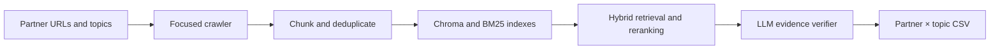

# Partner–topic matching pipeline

A Python prototype that estimates whether a partner's public web pages provide evidence for a topic. I built the focused crawler, chunking and deduplication step, dense and BM25 indexing, FastAPI retrieval and reranking, and LLM-based evidence verification. The output is a partner × topic CSV with labels, confidence, rationale, and source quotes.

This public portfolio edition contains code and fictional configuration examples. It excludes collected pages, indexes, generated proposal documents, and project-specific results.

## How it works



The crawler limits itself to the partner's allowed domains and checks robots.txt. Dense retrieval uses the same SentenceTransformer model at indexing and query time. BM25 results are filtered to the requested partner. The verifier returns `Yes`, `Weak`, or `No` from retrieved snippets, and accepts evidence only when the quoted text appears in a snippet with the matching URL. A human should review the labels and quotes before using them for decisions.

## Components

| Folder | Purpose |
| --- | --- |
| `seed-data` | Fictional YAML examples and schema validation |
| `focused-crawler` | Domain-limited public page collection |
| `chunker-deduper` | Text chunks and near-duplicate removal |
| `embedding-indexer` | SentenceTransformer embeddings in Chroma |
| `retriever-service` | FastAPI dense/BM25 retrieval and reranking |
| `verifier-service` | FastAPI LLM verifier and matrix builder |
| `shared-contracts` | Pydantic models shared across services |

## Quick check

Use Python 3.11 or newer. In PowerShell from this repository's root:

```powershell
python -m venv .venv
.\.venv\Scripts\Activate.ps1
pip install -e .\shared-contracts pyyaml
python .\seed-data\validate.py
```

This should create `seed-data/build/partners.json` and `topics.json` from the fictional YAML. The configured `example.com` partner is a placeholder; substitute a domain you are allowed to crawl for an actual run.

For the full pipeline, install each component's `requirements.txt`, then use the component READMEs for its commands. Run the crawler, chunker, embedding indexer, and optional BM25 builder in that order. Set `CHROMA_PATH` to the indexer's persistence directory and `WHOOSH_INDEX` to the optional BM25 directory, then start the retriever on port 8001 and verifier on port 8002 in separate terminals. The verifier defaults to local Ollama; see its README for configuration. Finally, from `verifier-service`, run:

```powershell
python -m app.build_matrix --topics ..\seed-data\build\topics.json --partners ..\seed-data\build\partners.json --retriever http://localhost:8001/hybrid --out matrix.csv
```

Model downloads and an installed Ollama model are needed for a full run. No real crawl data or measured evaluation results are included here. This is a prototype: LLM confidence is a model output, not a calibrated probability; retrieval quality depends on source coverage and manually reviewed evidence.
